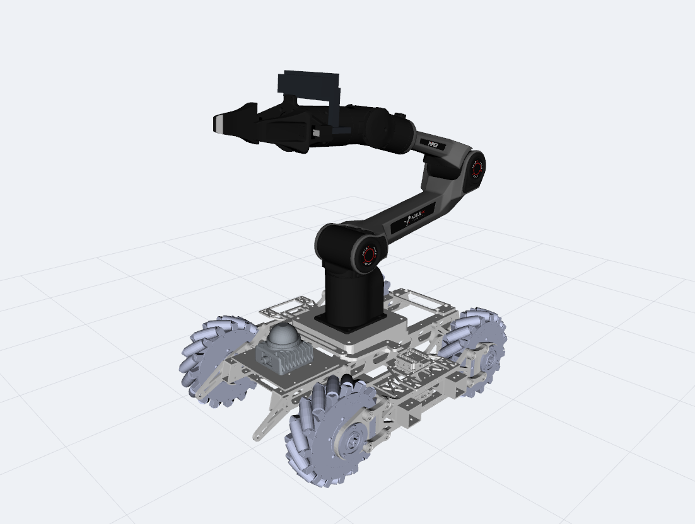
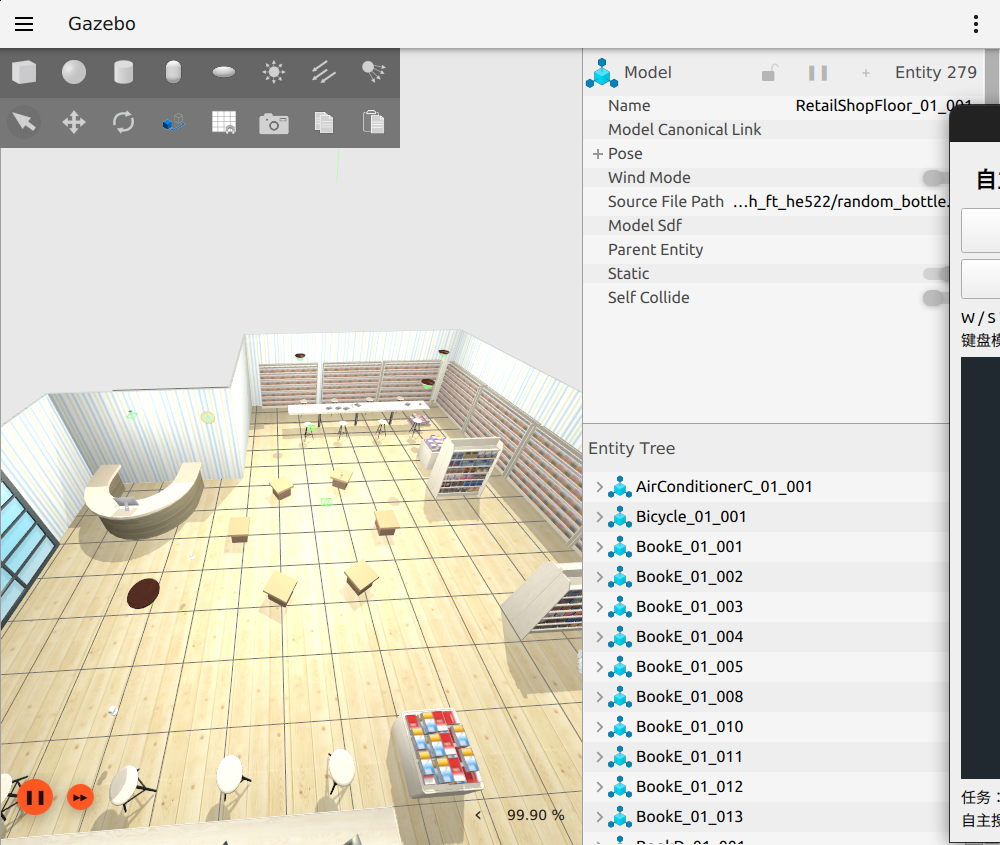
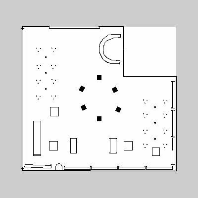
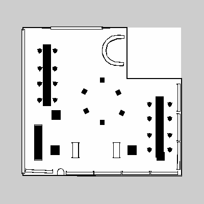
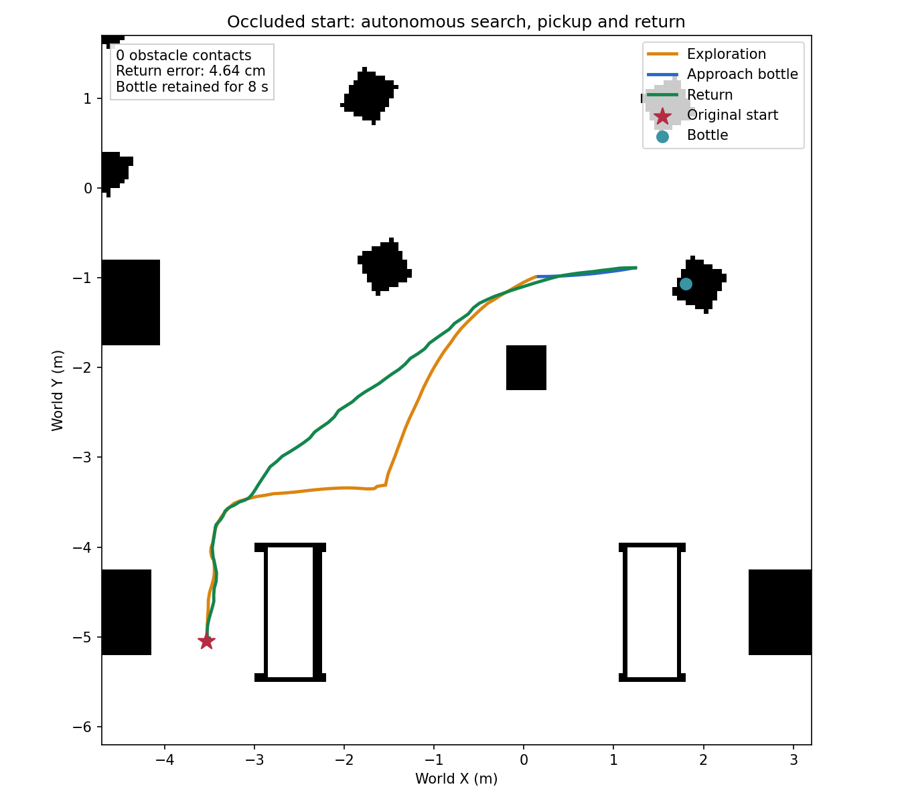
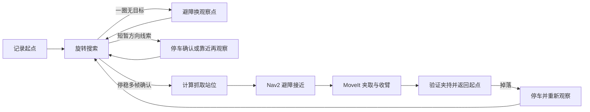

<div align="center">

# ScoutFetch

### 让移动机器人自己找到瓶子，抓起来，再带回出发点。

**Autonomous search, physical grasping, and return — built with ROS 2.**


[场景与模型](#场景地图与机器人模型) · [快速开始](#快速开始) · [功能亮点](#功能亮点) · [实测结果](#实测结果) · [项目结构](#项目结构) · [当前边界](#当前边界)

</div>

ScoutFetch 是一个面向移动操作研究与学习的 ROS 2 项目。它把视觉、导航、机械臂与
任务编排连接起来：矿泉水瓶随机出现在可抓取的台面上，机器人从当前位置开始搜索，
发现目标后避障靠近、规划站位、实际夹取并携瓶返回。

项目采用麦克纳姆轮底盘、Piper 六轴机械臂、夹爪、D435i 与 Mid-360 的实机模型，
提供统一的关节、TF、传感器、控制与任务接口。Gazebo、MoveIt、Nav2 和任务层共享
模型及接口定义，通过后端适配实现可迁移性。

## 场景地图与机器人模型

### 机器人模型

<p align="center">
  
</p>

上图为 RViz 中直接截取的整机模型视图，加载项目 Xacro/URDF，并使用配置的初始关节位置。
相机通过双侧 L 型支架连接腕部，相机安装位姿与外参坐标系保持原配置。
模型定义与尺寸见 [机器人模型说明](docs/robot_model.md)。

### 书店场景

<p align="center">
  
</p>

场景保留外围书架与阅读区，中央布置六个低位取物台，提供随机瓶子摆放和机器人探索空间。

### 场景地图

| AMCL 定位地图 | Nav2 导航地图 |
|:---:|:---:|
|  |  |

地图由项目场景生成器导出，示例使用 `seed:=7 station:=2`。定位地图对应雷达高度的
场景切片，导航地图额外覆盖家具碰撞几何；白色为自由空间，黑色为障碍，灰色为未知区域。

### 自主任务轨迹

<p align="center">
  
</p>

*来自独立 Gazebo 观察器的实际运行轨迹：从看不到瓶子的起点出发，换观察位置、抓取并返回。
这是 2026-11-15 指定场景的一次验收结果，详细数据见下方记录。*

## 功能亮点

| 能力 | 机器人会做什么 |
|---|---|
| 自主搜索 | 默认以 0.25 rad/s 连续旋转；一圈未找到目标，就选择新的可通行观察点 |
| 记住短暂线索 | 远处瓶子只出现一小会儿，也能记住方向；确认失败时先避障靠近，再观察 |
| 实时视觉 | 控制窗口直接显示 YOLO 检测框、类别和置信度 |
| 导航与抓取协同 | 结合实时代价地图、底盘净空、机械臂 IK、接近与抬升路径选择抓取站位 |
| 物理夹取 | 使用实际夹爪接触、闭合、提起和收臂，携物状态由反馈检查 |
| 掉落恢复 | 携物途中检测到掉瓶后停车，重新观察并有限次重抓，保留原返回点 |
| 随时接管 | 键盘控制与自主任务可切换；松开按键、窗口失焦时停止手动运动 |
| 实机模型与可迁移接口 | 使用实机整机模型与公共接口，通过后端适配复用感知、导航、抓取和任务代码 |

识别由 YOLOv8s 完成，探索移动采用地图覆盖与连通性规划。搜索方向来自相机、深度与 TF；
Gazebo 物体真值仅用于场景布置和独立验收，不输入自主控制策略。

## 快速开始

### 环境与构建

当前开发环境为 **Ubuntu 22.04、ROS 2 Humble、Gazebo Fortress**，需要配套的
`ros_gz`、`gz_ros2_control`、Nav2、MoveIt 2 和 ROS 2 控制器。
以下命令假设 ROS 2 与 Gazebo 已安装，仓库位于 `~/ScoutFetch`；
克隆到其他目录时替换第一行路径。

```bash
cd ~/ScoutFetch
source /opt/ros/humble/setup.bash

# 系统已初始化 rosdep 后安装工作空间依赖
rosdep install --from-paths src --ignore-src -r -y --rosdistro humble

# ONNX 推理依赖；沿用 Humble 的系统 numpy，避免自动升级
python3 -m pip install --user --no-deps onnxruntime==1.16.3

colcon build --symlink-install
source install/setup.bash
```

视觉包包含 YOLO ONNX 模型。统一随机搜索入口选用 YOLOv8s，通用检测启动文件保留
YOLOv8n 默认值；配置方法见 [视觉模块说明](src/scoutfetch_vision/README.md)。
上述步骤尚未在全新系统上进行从零安装验收，缺失依赖请结合 rosdep 输出检查。

### 启动书店任务

```bash
source /opt/ros/humble/setup.bash
source install/setup.bash
ros2 launch scoutfetch_mission sim_bookstore_search.launch.py
```

启动后会打开 Gazebo 和键盘 / 自主控制窗口，默认处于手动模式。
**点击控制窗口，再按 2，机器人就从当前位置开始自主找瓶。**

| 按键 | 操作 |
|---|---|
| W / S | 前进 / 后退 |
| A / D | 左 / 右横移 |
| Q / E | 左 / 右旋转 |
| 1 | 切回手动模式 |
| 2 | 开始自主搜索、抓取与返回；已夹持时继续原任务返回 |
| 空格 | 停止并切回手动模式 |

移动键按住有效，松开或切出窗口即停止。导航切换会等待取消确认；机械臂正在夹取时，
手动接管会等待当前机械臂动作结束并收臂。退出时在启动终端按 **Ctrl+C**，等待进程退出再重启。

### 换一种场景或运行方式

```bash
# 固定随机种子与台面，便于复现
ros2 launch scoutfetch_mission sim_bookstore_search.launch.py seed:=7 station:=2

# 就绪后自动启动任务
ros2 launch scoutfetch_mission sim_bookstore_search.launch.py auto_start:=true

# 原实验室场景：瓶子与支撑椅随机出现在 1.6–2.4 m 范围内
ros2 launch scoutfetch_mission sim_bottle_search.launch.py radius_min:=1.6 radius_max:=2.4

# 无窗口运行；无需键盘即可自动开始
ros2 launch scoutfetch_mission sim_bookstore_search.launch.py gui:=false control_gui:=false rviz:=false auto_start:=true
```

每次运行只启动一个完整仿真实例。常用参数如下：

| 参数 | 默认值 / 用途 |
|---|---|
| `seed` | `-1` 随机；非负整数复现场景布局 |
| `station` | `-1` 随机台面；`0..5` 指定书店取物台 |
| `auto_start` | `false`，等操作者启动；设为 `true` 就绪后自动开始 |
| `search_angular_speed` | `0.25` rad/s，自主扫描转速 |
| `search_continuous_rotation` | `true`；设为 `false` 使用分段扫描 |
| `exploration_enabled` | `true`；设为 `false` 只在原地扫描 |
| `spawn_bottle` | `true`；设为 `false` 观察无目标搜索行为 |
| `gui` / `control_gui` / `rviz` | 控制 Gazebo、操作窗口和 RViz 的显示 |

书店保留外围书架与阅读区，中央设置六个高 **0.46 m** 的取物台。随机位置限定在
经过支撑与接近检查的台面内。原实验室的 `radius_min/radius_max` 参数不用于书店布置。

## 任务如何工作



短暂线索需要至少两帧方向一致的瓶子检测。若停车后仍不能获得可靠三维确认，
会尝试沿该方向选择 **1.5 m 内**的连通安全观察点，到位重新识别；线索不会直接成为
抓取坐标。线索会过期或在换点、手动接管时清除。

导航和搜索速度统一经过 Collision Monitor；遇到障碍时可能减速或停车。
任务最初记录的返回点在探索、抓取和掉落恢复过程中保持不变。

## 实测结果

已完成 Gazebo 中的遮挡起点探索、物理抓取返回、掉落恢复与短暂视觉线索验证。
指定书店场景的返回误差为 4.64 cm，掉落重抓场景为 3.31 cm，两次返回后均保持夹持约 8 秒。
一秒视觉线索测试成功靠近后重新确认目标，该测试在抓取前结束。
以上是特定配置下的仿真记录；摘要数据见 [results.json](docs/results.json)。

```bash
# 可执行回归测试
colcon test --event-handlers console_direct+
colcon test-result --verbose
```

## 项目结构

```text
ScoutFetch/
├── README.md                 安装、使用与项目介绍
├── LICENSE / NOTICE          许可与归属声明
├── LICENSES/                 第三方许可正文
├── THIRD_PARTY_NOTICES.md    模型、权重和场景来源
├── src/                      ROS 2 功能包及自动测试
└── docs/
    ├── robot_model.md        整机参数与接口参考
    ├── assets/               场景、地图和机器人图片
    ├── model_provenance.json 网格来源匹配数据
    └── results.json          运行结果摘要
```

`build/`、`install/`、`log/`、`artifacts/` 是由 Git 忽略的本地生成/归档目录。

| ROS 2 功能包 | 职责 |
|---|---|
| [scoutfetch_description](src/scoutfetch_description/README.md) | 唯一整机 Xacro、CAD 网格、关节与传感器 TF |
| [scoutfetch_sim](src/scoutfetch_sim/README.md) | Gazebo 世界、物理控制、传感器与后端适配 |
| [scoutfetch_navigation](src/scoutfetch_navigation/README.md) | SLAM Toolbox、AMCL、Nav2 全向导航与避障 |
| [scoutfetch_moveit_config](src/scoutfetch_moveit_config/README.md) | 仿真 / 实机共用的 MoveIt 模型和控制器配置 |
| scoutfetch_interfaces | 共用夹爪与机械臂消息 |
| [scoutfetch_vision](src/scoutfetch_vision/README.md) | YOLO 检测、RGB / 深度对齐与目标定位 |
| scoutfetch_reach | 可通行且机械臂可达的底盘站位筛选 |
| scoutfetch_grasp | 接近、夹取、抬升、收臂与夹持反馈 |
| [scoutfetch_mission](src/scoutfetch_mission/README.md) | 搜索、探索、模式切换、抓取、返回与恢复 |

公共消息现在由 `scoutfetch_interfaces` 提供。连接外部实机驱动时，驱动或适配层应
使用相同的消息类型，例如 `scoutfetch_interfaces/msg/GripperStatus`；旧消息包中的
同名类型需要显式转换，不能仅靠相同话题名称连接。

底盘为麦克纳姆轮移动平台，搭载 Piper 六轴机械臂、夹爪、D435i 与 Mid-360 模型。
公共根坐标系为 `base_link`，机械臂末端为 `gripper_tcp`。
后端适配层提供 `/Odometry`、`/livox/scan`、相机、关节与控制接口，上层功能通过
ROS 2 接口协作。详细几何与标定见 [机器人模型](docs/robot_model.md)，
该文档同时说明模型与接口的可迁移性。

## 当前边界

- **任务对象和摆放范围有限。** 当前围绕矿泉水瓶与可接近台面设计；掉落恢复已验证地面直立瓶，尚未验证任意倒伏物体抓取。
- **抓取站位计算仍需提速。** 书店会筛选数百个候选，近期日志约需 18–20 秒；相同相对姿态的缓存复用尚未实现。
- **雷达仿真有简化。** `/livox/lidar` 来自二维 GPU LiDAR 转换，不等同于 Mid-360 的非重复三维扫描，不能据此验收 Point-LIO。
- **环境认知依赖既有导航链路。** 书店任务使用场景生成的地图与 AMCL；SLAM 建图由导航包提供单独入口。

## 参与贡献

欢迎围绕运行复现、站位计算提速、更多物体与场景、实机标定和回归验证提交 Issue 或 PR。
报告问题时，请附上系统版本、启动命令、随机种子 / 台面编号、任务阶段，以及相关节点日志。
修改涉及任务行为时，请说明复现场景与验证范围，并保留对应运行证据。


## 许可证与第三方资源

书店场景改编自 [AWS RoboMaker Bookstore World](https://github.com/aws-robotics/aws-robomaker-bookstore-world)，
随附 [原始许可](src/scoutfetch_sim/models/aws_bookstore/LICENSE) 和
[来源记录](src/scoutfetch_sim/models/aws_bookstore/SOURCE.json)。
YOLOv8s 权重的来源、导出信息与上游许可链接见
[模型元数据](src/scoutfetch_vision/models/yolov8s.metadata.json)。

ScoutFetch 自有贡献的 Apache-2.0 正文见 [LICENSE](LICENSE)，适用范围及归属见
[NOTICE](NOTICE)。第三方代码、模型和场景保留各自许可，详见
[THIRD_PARTY_NOTICES.md](THIRD_PARTY_NOTICES.md)。YOLO 模型的 AGPL 条款单独适用；
改装模型的来源、上游许可和待补充项见上述第三方清单。
